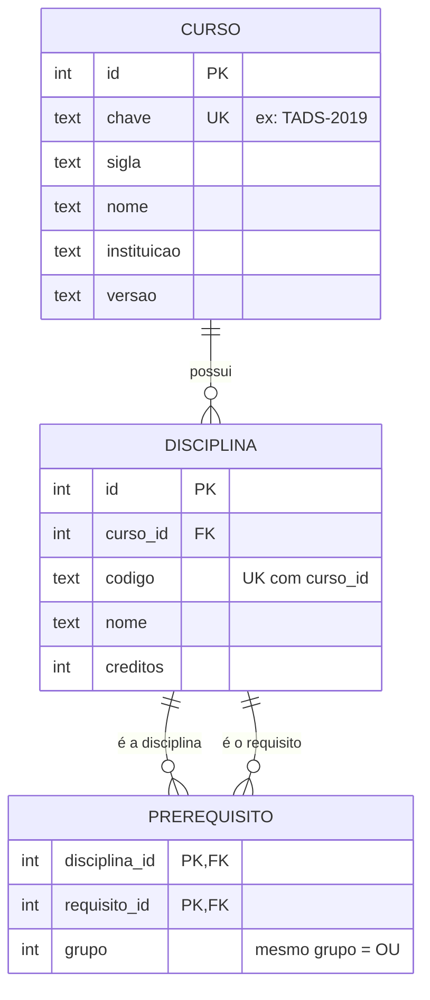
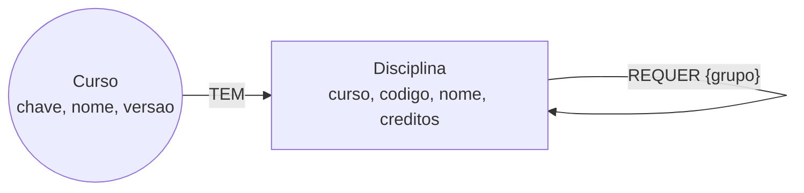

# Modelos lógicos

Regra de pré-requisito (igual nos 3 modelos): cada disciplina tem uma lista de **grupos**.
Grupos diferentes = **E**; disciplinas dentro do mesmo grupo = **OU**.
Ex.: TAD0156 = (TAD0102) E (TAD0012) E (TAD0103); TAD0029 = (TAD0009 OU TAD0103 OU TAD0111).

## a) Relacional (PostgreSQL)



## b) Documentos (MongoDB)

Coleção `cursos` (um documento por curso) e coleção `disciplinas` (um documento por disciplina, com os pré-requisitos embutidos):

```json
{
  "curso": "TADS-2019", "codigo": "TAD0156", "nome": "Projetos Aplicados I", "creditos": 4,
  "grupos": [["TAD0102"], ["TAD0012"], ["TAD0103"]],
  "requisitos": ["TAD0102", "TAD0012", "TAD0103"]
}
```
`grupos` guarda a regra E/OU; `requisitos` é a lista achatada, usada em índice e no `$graphLookup`. Índices: único (`curso`,`codigo`) e (`curso`,`requisitos`).

## c) Grafo (Neo4j)


Restrição de unicidade em (`Disciplina.curso`, `Disciplina.codigo`).

## Justificativa de cada banco

- **PostgreSQL**: a estrutura é regular (curso, disciplina, pré-requisito) e a integridade importa (FKs, unicidade de código por curso). Pré-requisitos em cadeia saem com `WITH RECURSIVE`.
- **MongoDB**: a disciplina é lida quase sempre com seus pré-requisitos, então embutir evita junções. Cadastrar um curso novo é inserir documentos. A cadeia usa `$graphLookup`, que é mais limitado que um grafo nativo.
- **Neo4j**: a estrutura é um grafo acíclico dirigido; "o que preciso cursar antes de X" e "o que X libera" são travessias diretas (`[:REQUER*1..]`).

## Escolha final (genericidade)

Recomendação: **PostgreSQL** como base oficial, mantendo o formato JSON de `data/` como fonte única de cadastro. Motivos: (1) integridade garantida pelo esquema, que impede código duplicado e pré-requisito apontando para disciplina inexistente; (2) o mesmo esquema serve a qualquer curso, bastando uma linha em `curso`; (3) com algumas dezenas de disciplinas, a diferença de desempenho entre os três é desprezível, então vence o que dá mais garantia de dados e é mais comum de manter. Neo4j valeria a pena se o foco virasse análise de grafos grandes (várias matrizes, equivalências entre versões). Confirmem isso com as medições do tempo de vocês.
